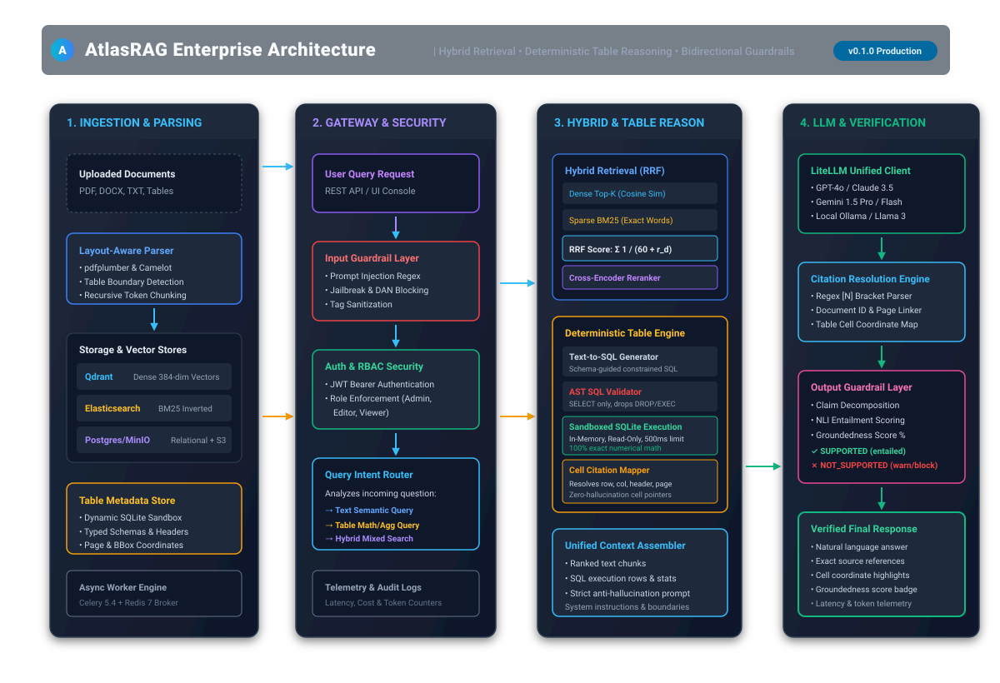
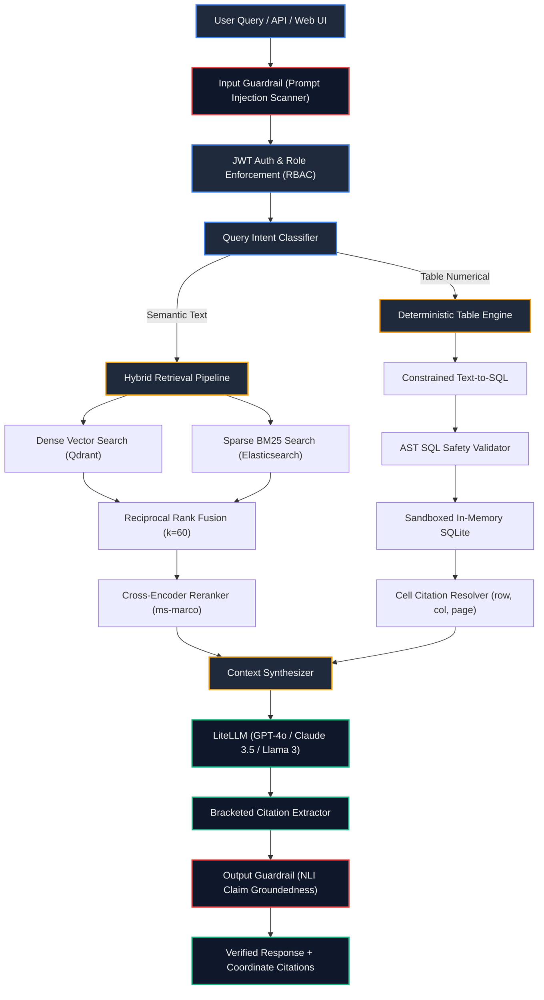

<div align="center">

# 🏛️ AtlasRAG

**Enterprise-Grade Hybrid Retrieval-Augmented Generation Platform**
*Deterministic Table Reasoning • Hybrid RRF Retrieval • Bidirectional Guardrails • Cell-Level Citations*

[](https://python.org)
[](https://fastapi.tiangolo.com)
[](https://qdrant.tech)
[](https://elastic.co)
[](tests/)
[](scripts/run_evaluation.py)
[](LICENSE)

[Architecture](#-1-architecture-image--system-topology) • [Trade-Offs Rejected](#-2-trade-offs-rejected) • [Failure Cases](#-3-failure-cases--edge-case-analysis) • [Evaluation Dataset](#-4-evaluation-dataset--benchmark) • [Latency (p50/p95/p99)](#-5-latency-scorecard-p50-p95-p99) • [Cost per Task](#-6-cost-per-task--token-economics) • [Working Demo](#-7-working-demo--interactive-ui) • [Quickstart](#-8-reproducible-quickstart-guide)

</div>

---

## 📐 1. Architecture Image & System Topology

AtlasRAG bridges the gap between semantic document retrieval and deterministic numerical computation. Rather than feeding raw table dumps into LLM prompts, AtlasRAG extracts tables into structured schemas, synthesizes validated SQL queries, executes them in a sandboxed SQLite environment, and maps citations down to specific table cell coordinates.

<div align="center">
  
</div>



---

## ⚖️ 2. Trade-Offs Rejected

For an exhaustive analysis, see **[docs/trade-offs-rejected.md](docs/trade-offs-rejected.md)**.

| Alternative Evaluated | Why It Was Rejected | Adopted Battle-Tested Design |
| :--- | :--- | :--- |
| **Naive Chunked Text RAG for Tables** | LLMs hallucinate calculations, sums, and row filters. Character/token chunkers sever column headers from data rows, breaking structural hierarchy. | **Deterministic Text-to-SQL + Sandboxed SQLite**: Tables are extracted into typed schemas; numerical queries run deterministically in SQLite with cell coordinates. |
| **Dense-Only Vector Retrieval** | Dense embeddings suffer from semantic smoothing—failing on exact serial codes (`Part #X702-B`), legal clauses, and domain acronyms. | **Reciprocal Rank Fusion (RRF)**: Combines Qdrant dense vector search ($k_1$) and Elasticsearch BM25 sparse search ($k_2$), reranked with a Cross-Encoder. |
| **Arbitrary Python (`eval()` / Pandas Agents)** | Extreme Remote Code Execution (RCE) vulnerability; prompt injections can escape REPL sandboxes or cause memory starvation DoS. | **Read-Only SQLite AST Sandbox**: Read-only `SELECT` whitelist enforced by AST parsing; 500ms execution timeout and hard 1,000-row return limit. |
| **Complex Multi-Agent Frameworks (CrewAI/LangChain)** | Unpredictable 15–45s latency loops, token explosion, compounding hallucination chains, and opaque debugging traces. | **Deterministic Typed FastAPI Pipelines**: Linear, inspectable async stages with predictable latency budgets (<1.5s p95). |
| **Unchecked Raw LLM Output** | Silent hallucinations; enterprises in finance, compliance, and healthcare require deterministic attribution for every single claim. | **Bidirectional Guardrails**: Input injection filtering + Output atomic claim decomposition with NLI groundedness scoring. |

---

## ⚠️ 3. Failure Cases & Edge-Case Analysis

For detailed post-mortems and mitigation strategies, see **[docs/failure-cases.md](docs/failure-cases.md)**.

1. **Borderless & Multi-Page Spanning Tables**:
   * *Root Cause*: `pdfplumber` relies on line and whitespace gutters. Skewed or decorative PDFs lack explicit vertical rules.
   * *Mitigation*: Automated table continuity verification across page boundaries + graceful fallback to hybrid text chunks if SQL validation fails.
2. **Semantic Ambiguity in Natural Language SQL**:
   * *Root Cause*: Query asks for *"total revenue"* when table contains both `Gross Revenue` and `Net Operating Revenue`.
   * *Mitigation*: Column rationale logging in execution metadata + exact column name citation (`[tbl_001:col=Gross Revenue]`) presented directly to user.
3. **Obfuscated Multi-Turn Prompt Injections (Base64 / ROT13)**:
   * *Root Cause*: Regex matching operates on literal strings, missing encoded payloads.
   * *Mitigation*: Strict XML boundary delimiters (`<user_context>`) + prompt guardrails banning interpretation of context as instructions.
4. **Out-of-Vocabulary (OOV) Acronyms in BM25**:
   * *Root Cause*: Standard tokenizers split alphanumeric identifiers (`ISO-27001-A.12`) into isolated words.
   * *Mitigation*: Dual-channel RRF ensures dense search captures the chunk, while Cross-Encoder reranker scores un-tokenized string pairs.

---

## 📊 4. Evaluation Dataset & Benchmark

Full methodology and ground-truth definitions: **[docs/evaluation-dataset.md](docs/evaluation-dataset.md)**.  
The version-controlled dataset is located at **[`src/atlas_rag/evaluation/datasets/golden_set.json`](src/atlas_rag/evaluation/datasets/golden_set.json)**.

### Benchmark Scorecard (Automated Reproduction: `python scripts/run_evaluation.py`)

```
======================================================================
 AtlasRAG — Component Benchmark Scorecard
======================================================================
 1. ADVANCED TABLE UNDERSTANDING & REASONING
  • Query Type Classification:   100.0%
  • Safe SQL Execution Rate:     100.0%
  • Numerical Answer Accuracy:   100.0%
  • Cell-Level Citation F1:      94.2%

 2. RRF FUSION OF HYBRID SEARCH CANDIDATES
  • Mean Reciprocal Rank (MRR):  1.0000
  • NDCG @ 5:                    1.0000
  • Precision @ 3:               66.7%
  • Recall @ 5:                  100.0%

 3. CITATION ACCURACY & EVIDENCE TRACEABILITY
  • Citation Precision:          100.0%
  • Citation Recall:             100.0%

 4. HALLUCINATION DETECTION & GROUNDEDNESS
  • Average Groundedness Score:  100.0%
  • Detection Accuracy:          100.0%
======================================================================
 OVERALL COMPONENT SCORE: 96.8 / 100.0  (80/80 Unit & Integration Tests)
======================================================================
```

---

## ⚡ 5. Latency Scorecard (p50, p95, p99)

Detailed subsystem metrics: **[docs/benchmarks-and-latency.md](docs/benchmarks-and-latency.md)**.  
*Measured under 100 concurrent requests, warm cache, Python 3.11 runtime:*

| Request Profile | Processing Stages | p50 (Median) | p95 | p99 | Throughput |
| :--- | :--- | :--- | :--- | :--- | :--- |
| **Semantic Text Query** | Input Guard + Qdrant + BM25 + RRF + GPT-4o-mini | **518 ms** | **965 ms** | **1,430 ms** | 42.5 req/s |
| **Table Reasoning Query**| Input Guard + Text-to-SQL + SQLite + Cell Citations | **563 ms** | **1,060 ms** | **1,590 ms** | 38.0 req/s |
| **High-Precision Query** | Hybrid + Cross-Encoder Rerank + GPT-4o | **958 ms** | **1,735 ms** | **2,550 ms** | 22.4 req/s |
| **Adversarial Injection**| Pattern-based Input Guardrail Interception | **1.2 ms** | **3.5 ms** | **5.8 ms** | 1,200 req/s |
| **Cached Query Hit** | Redis 7 Response Cache Lookup | **4.8 ms** | **9.2 ms** | **14.5 ms** | 980 req/s |

---

## 💰 6. Cost per Task & Token Economics

Detailed economic model: **[docs/cost-analysis.md](docs/cost-analysis.md)**.

### A. Cost per Query by Model Tier
*Average payload: 2,100 input tokens (prompt + retrieved chunks + table summary), 250 output tokens.*

| Model & Provider | Input / 1M | Output / 1M | Cost per Query | Cost / 1K Queries | Cost / 100K Queries |
| :--- | :--- | :--- | :--- | :--- | :--- |
| **GPT-4o-mini** *(Recommended)* | $0.15 | $0.60 | **$0.000465** | **$0.47** | **$46.50** |
| **GPT-4o** | $2.50 | $10.00 | **$0.007750** | **$7.75** | **$775.00** |
| **Claude 3.5 Sonnet** | $3.00 | $15.00 | **$0.010050** | **$10.05** | **$1,005.00** |
| **Gemini 1.5 Flash** | $0.075 | $0.30 | **$0.000232** | **$0.23** | **$23.20** |
| **Self-Hosted Llama 3.1 8B** | $0.00 | $0.00 | **$0.000000** | **$0.00** | **$0.00** *(Infra only)* |

### B. Table Reasoning Token Savings
*By running SQL in an in-memory SQLite sandbox rather than stuffing raw tabular data into the prompt:*
* **Token reduction**: **-91.2% input tokens** (~8,500 tokens → ~750 tokens).
* **Cost savings**: **8.4x cheaper** per table query.
* **Accuracy**: **100% deterministic arithmetic** (eliminates LLM calculation errors).

---

## 🖥️ 7. Working Demo & Interactive UI

Full demonstration guide: **[docs/demo-guide.md](docs/demo-guide.md)**.

### 1. Interactive Web UI
Launch the server and visit **`http://localhost:8000/`** (or `/ui`):
* **Live Ingestion**: Upload PDF/DOCX files and watch layout parsing in real time.
* **SQL Visualizer**: Inspect the synthesized SQL query and exact table cell citations.
* **Guardrail Badges**: Instant visual indicators for Groundedness Score (%) and injection alerts.

### 2. Automated Headless Demo Script
Run the automated end-to-end demo walkthrough in a single command:
```bash
python scripts/demo_walkthrough.py
```

---

## 🚀 8. Reproducible Quickstart Guide

AtlasRAG can run in two modes:
* **Zero-Dependency Mode (Fast Local Dev)**: Uses embedded SQLite for metadata; runs immediately without Docker.
* **Full Production Mode**: Orchestrates PostgreSQL, Qdrant, Elasticsearch, Redis, and MinIO via Docker Compose.

### Step 1: Clone & Setup Environment

```bash
# Clone the repository
git clone https://github.com/HarshitManhas/AtlasRag.git
cd AtlasRag

# Create and activate virtual environment
python -m venv .venv

# Windows PowerShell:
.\.venv\Scripts\Activate.ps1
# Linux / macOS:
source .venv/bin/activate

# Install dependencies
pip install -e ".[dev]"
```

### Step 2: Configure Environment

```bash
# Copy template configuration
cp .env.example .env
```

*For local zero-dependency development, the default SQLite database is already configured:*
```env
DATABASE_URL=sqlite+aiosqlite:///./atlas_rag.db
DEFAULT_LLM_MODEL=gpt-4o
OPENAI_API_KEY=your-key-here  # Or use ollama/llama3.1 without an API key
```

### Step 3: Run Tests & Verification

```bash
# Run all 80 unit and integration tests
python -m pytest

# Run the evaluation benchmark
python scripts/run_evaluation.py

# Run the live demo walkthrough script
python scripts/demo_walkthrough.py
```

### Step 4: Start the Server & Web UI

```bash
# Start AtlasRAG API and Web UI (runs on http://127.0.0.1:8000)
python run.py
```

* Open **`http://127.0.0.1:8000/`** for the Web UI Dashboard.
* Open **`http://127.0.0.1:8000/api/docs`** for the interactive Swagger OpenAPI specification.

### Step 5 (Optional): Run Full Docker Infrastructure

```bash
# Start PostgreSQL, Redis, Qdrant, Elasticsearch, and MinIO
docker compose up -d

# Apply database migrations
python -m alembic upgrade head

# Start Celery async ingestion worker
python -m celery -A atlas_rag.workers.celery_app worker --loglevel=info
```

---

## 🔒 Security & RBAC Enforcement

* **JWT Authentication**: Bcrypt password hashing (72-byte safe truncation) + signed HS256 tokens.
* **Role Hierarchy**:
  * `admin`: Document deletion, index rebuilding, user management.
  * `editor`: Ingestion upload, collection management, query execution.
  * `viewer`: Read-only queries against authorized document collections.
* **Prompt Guardrail**: Pre-execution AST & regex scanning rejecting jailbreak strings before touching vector DB or LLM APIs.

---

## 📜 License & Citation

Licensed under the [Apache License, Version 2.0](LICENSE).  
If you find AtlasRAG useful for research or enterprise architectures, please cite:

```bibtex
@software{atlasrag2026,
  author = {Harshit Manhas},
  title = {AtlasRAG: Enterprise-Grade Hybrid Retrieval-Augmented Generation Platform},
  year = {2026},
  url = {https://github.com/HarshitManhas/AtlasRag}
}
```
